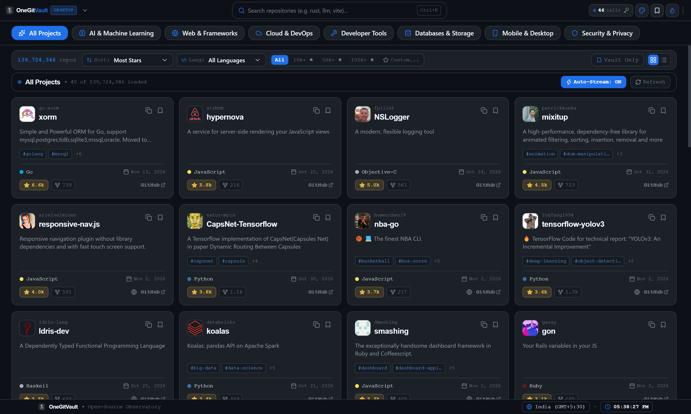
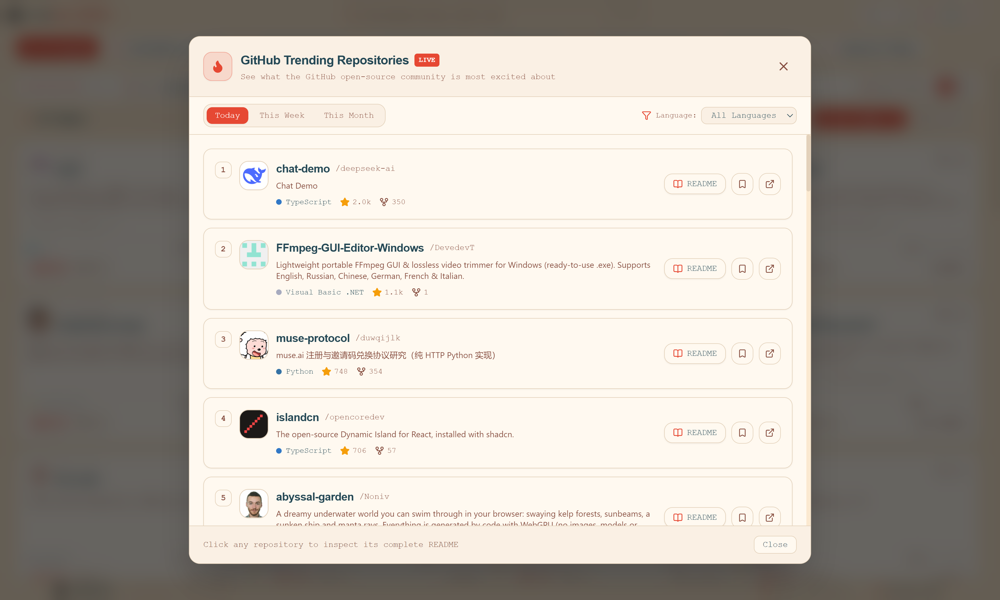
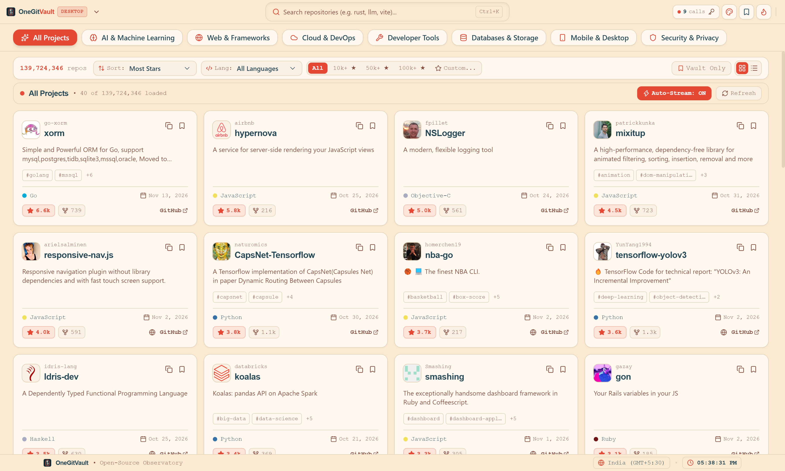

# Building OneGitVault: A High-Performance Windows Observatory for Open-Source Exploration

As developers, discovering game-changing open-source software is part of our daily workflow. Whether it’s finding a new LLM agent framework, a blazingly fast Rust CLI tool, or an ultra-lean CSS micro-library, staying on top of open source is how we learn and build better software.

Yet, our discovery workflow today is notoriously fragmented:
- **Browser Tab Sprawl**: You read an article, see 5 interesting GitHub projects, open each in a new tab, open their READMEs, and suddenly have 45 tabs competing for your RAM and focus.
- **GitHub's Web UI Isn't Built for Fast Triage**: GitHub is fundamentally built for *repository and code management*—pull requests, issues, commits, and tree navigation. It's not optimized for high-density skimming, live continuous streaming, or instant local bookmarking.
- **Anonymous Rate Limits**: Browsing anonymously on GitHub hits the strict 60 requests/hour ceiling within 15 minutes of active exploration.
- **Release Assets Are Buried**: Downloading a release `.exe` or `.zip` often takes 3 to 4 clicks navigating past source tags and assets foldouts.
- **Star Clutter**: When you star everything you find interesting, your starred list balloons into thousands of unorganized repos with no offline access or private backup.

To solve this, I designed and built **OneGitVault**—a fast, standalone Windows desktop application and open-source observatory built with **Electron 33**, **React 18**, **TypeScript**, and **Tailwind CSS**.

In this article, I want to break down the architectural design decisions, the problem domain it solves, its technical highlights, and how you can run or install it.

---

## 🎯 The Core Problem & Use Cases

### 1. High-Density Discovery vs. Dead Margin Waste
Most web applications artificially limit screen usage to narrow containers (e.g. `max-w-4xl` or `max-w-6xl`), leaving hundreds of empty pixels on widescreen monitors. 

In **OneGitVault v2.0.0**, the canvas expands dynamically to `max-w-[1720px]`, hosting an ergonomic **4-column responsive grid** (`xl:grid-cols-4 2xl:grid-cols-4`). Each repository card is compact, lightweight, and packs all essential telemetry:
- Owner and repository identity
- Visual clone copy button (`git clone <url>.git`) with animated feedback
- Quick-toggle Vault bookmark button
- Live star and fork metrics
- Accurate language color indicator and license information
- Clean two-line clamped descriptions and interactive topic chips



---

### 2. In-App GitHub Trending (Zero Redirection)
Usually, checking GitHub Trending requires navigating out of your flow to `github.com/trending`, scrolling through a browser list, and opening separate tabs.

OneGitVault introduces an **In-App GitHub Trending Explorer** accessible directly from the titlebar (`🔥` icon). It allows you to:
- Switch seamlessly between **Today**, **This Week**, and **This Month**.
- Filter trending repositories by language.
- Inspect the complete README and releases directly in an overlay modal without losing your current search or scroll position.



---

### 3. Immediate README & Release Asset Inspection
Clicking any repository tile opens a centered, distraction-free markdown documentation viewer:
- **GitHub Flavored Markdown (GFM)**: Renders headers, code blocks, tables, callouts, and directory structures.
- **Security Sanitization with DOMPurify**: Untrusted markdown from arbitrary repositories is cleansed of `<script>`, `onerror`, and XSS attack vectors.
- **Releases Downloader**: A dedicated tab lists official GitHub release tags and changelogs, offering direct single-click binary downloads (`.exe`, `.zip`, `.tar.gz`) straight to your local drive.


---

### 4. Modular Plugin-Based Theme Engine
Instead of just a simple dark/light boolean toggle, OneGitVault implements a type-safe `ThemePlugin` contract with a central `ThemeRegistry`. The app includes 5 high-contrast themes:

1. **Prometheus Dark**: Deep cinematic petrol teal (`#0c1519` / `#16272f`) with vermilion flame accents (`#e64833`) and biscuit text.
2. **Sand & Ivory Light**: Warm biscuit sand canvas (`#FBE9D0`) with crisp ivory cards (`#FFF9F0`) and terracotta highlights.
3. **Ambient Twilight**: Cool midnight slate (`#0a0e14` / `#161e2b`) with serene sky-cyan accents (`#38bdf8`) for zero eye fatigue.
4. **GitHub Simple Light**: Crisp white cards with classic GitHub blue highlights (`#0969da`).
5. **GitHub Simple Dark**: Deep GitHub slate canvas (`#0d1117`) with elevated containers and gold star badges.

A floating portal popover with live dual preview swatches allows instant theme switching.



---

### 5. Private GitHub Gist Cloud Sync
Bookmarks shouldn't be locked into a single machine. While OneGitVault functions completely locally via `localStorage`, users can connect a personal GitHub access token (with `gist` scope) to enable **Push (Backup)** and **Pull (Restore)**. Your vault is synchronized to your personal GitHub account as a private Gist (`onegitvault-bookmarks.json`).

---

## 🏛️ Runtime Architecture & Technical Decisions

```
OneGitVault/
├── assets/                  # High-res application icons and screenshots
├── electron/
│   ├── main.cjs             # Electron main process (IPC, window lifecycle, shell integration)
│   └── preload.js           # Secure context-isolated bridge (electronAPI)
├── src/
│   ├── components/          # TitleBar, CategoryNav, FilterBar, ProjectCard, TrendingModal, RepoDetailPanel
│   ├── hooks/               # Domain hooks (useRepositories, useBookmarks)
│   ├── services/            # Pure services (githubApi, rateLimit, storage, updateService)
│   ├── themes/              # Modular ThemePlugin registry (5 themes)
│   └── types/               # TypeScript domain contracts
```

### Why React 18 + Vite + Electron?
- **Vite 5**: Delivers sub-second Hot Module Replacement (HMR) in development and bundles lightweight chunks (under 390 kB gzip) for instant desktop startup.
- **Context Isolation & Sandbox**: The Electron process is configured with `nodeIntegration: false`, `contextIsolation: true`, and `sandbox: true`. External links are intercepted and routed safely to the system browser using `shell.openExternal`.
- **IntersectionObserver Auto-Streaming**: Repositories are fetched in 40-item pages. As the user scrolls down, an `IntersectionObserver` sentinel automatically triggers the next page query before reaching the end.
- **Zero-Downtime Offline Fallback**: If network connectivity drops or the user hits GitHub's unauthenticated hourly rate limit, the application seamlessly falls back to a curated offline repository dataset.

---

## ⌨️ Desktop Ergonomics & Shortcuts

| Shortcut | Function |
|---|---|
| `Ctrl + K` / `Cmd + K` | Open / Close Search Flyout with Quick Topic Tags |
| `Escape` | Instantly Dismiss Modals, Popovers, or Search Flyout |
| `Ctrl + R` | Refresh Current Repository Stream & Update Quota Badge |
| `Double Click Header` | Maximize / Restore Window |

---

## 📦 Download & Getting Started

### 1. Windows Setup Installer (Recommended)
You can download the single-file installer directly from the releases page:
- 💾 **Download**: [**`OneGitVault-Setup-2.0.0.exe`**](https://github.com/VKaddala/OneGitVault/releases/tag/v2.0.0) (~84 MB)

The installer is powered by Inno Setup 6: it automatically detects, uninstalls, and cleanly replaces previous versions without creating orphan files or registry remnants.

### 2. Standalone Portable Binary
If you prefer running without installation:
```powershell
release\OneGitVault-win32-x64\OneGitVault.exe
```

### 3. Run from Source
If you want to contribute, inspect the code, or build it yourself:

```powershell
# 1. Clone the repository
git clone https://github.com/VKaddala/OneGitVault.git
cd OneGitVault

# 2. Install dependencies
npm.cmd install

# 3. Start in Desktop Mode (Electron + Vite HMR)
npm.cmd start
```

---

## 🌟 Links & Repository

- **GitHub Repository**: [https://github.com/VKaddala/OneGitVault](https://github.com/VKaddala/OneGitVault)
- **v2.0.0 Release & Binaries**: [https://github.com/VKaddala/OneGitVault/releases/tag/v2.0.0](https://github.com/VKaddala/OneGitVault/releases/tag/v2.0.0)
- **License**: MIT License

If you find OneGitVault helpful for keeping track of open-source projects, feel free to drop a ⭐ on GitHub and share your thoughts in the comments below! What features would you like to see next?
