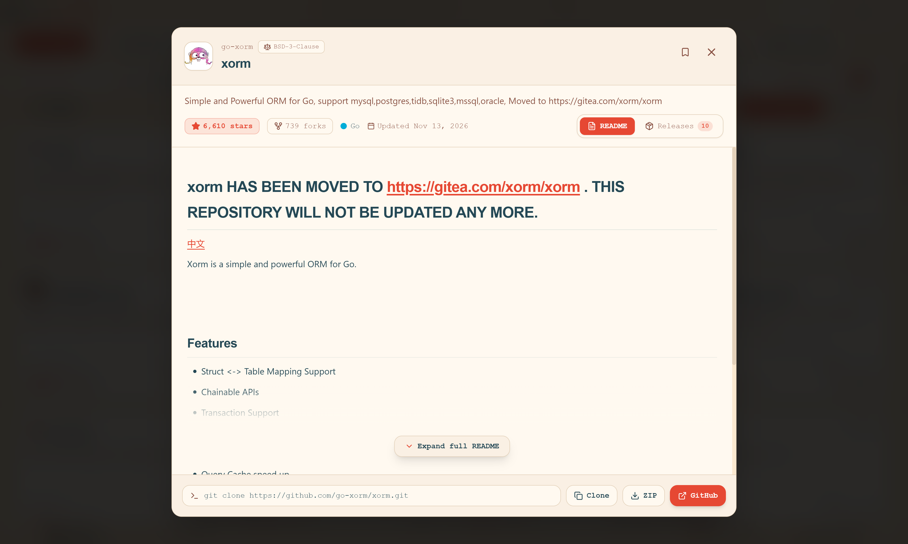

# I Built an Open-Source Observatory for Windows: Here's Why Browsing GitHub Needed a Redesign

Imagine walking into a massive library where every interesting book you touch forces you to open a new table in another room. Within 15 minutes, you’re sprinting between 40 different tables just to remember why you walked in.

That is what discovering open-source software feels like today in a web browser.

Whether you are a developer looking for tools, an enthusiast hunting for emerging AI projects, a tech founder researching the landscape, or a student learning to build things, you rely on GitHub. But **GitHub’s website was never built for rapid exploration—it was built for project maintenance and code hosting.**

To solve this, I designed and built **OneGitVault**: a standalone Windows desktop app that turns open-source discovery into a high-density, calm, and distraction-free visual observatory.

Here is the story of the problem, the high-level design decisions behind the app, and how you can try it today.

---

## 🌪️ The Problem: Why Browsing Open Source Feels Broken

If you have ever spent a Saturday morning looking for cool software on GitHub, you’ve likely experienced these frustrations:

### 1. Browser Tab Paralysis
You find a cool trending list. You middle-click 6 repositories. Each repository has a README file you want to skim. Each README links to other projects. Before you know it, your browser has 30+ tabs open, your computer's fans spin up, and your original train of thought is gone.

### 2. Wasted Screen Real Estate
Most web pages are designed like narrow mobile columns centered on your giant desktop monitor. On a modern widescreen display, half the screen is just empty gray space on the left and right.

### 3. Too Much Friction for Simple Answers
When you look at a project, you usually just want to answer three quick questions:
- *What does this do, and what does it look like?*
- *How popular and actively maintained is it?*
- *How do I download it or test it right now?*

On the web, answering those three questions means clicking through multiple pages, jumping past file directories, and hunting for release tabs.

---

## 💡 High-Level Design Philosophy: How OneGitVault Redesigns the Experience

Rather than writing another browser extension or website, I stepped back and designed OneGitVault around five core principles:

---

### 1. The "Zero-Tab" Rule: Stay in the Flow
**The Decision:** Everything you need to evaluate a repository happens in the same window.

In OneGitVault, clicking any project tile opens a smooth, centered reading panel with its complete documentation. You can read the guides, view diagrams, copy the install commands, or download executable releases directly to your machine. 

When you're done, simply press **`Escape`** or click outside. You are immediately back at your exact scroll position in the gallery—no tabs to close, no reloading, and no lost context.



---

### 2. High-Density 4-Column Canvas: Respecting Your Screen
**The Decision:** Make the most of modern monitors without visual clutter.

Instead of stretching a single column or drowning you in tiny spreadsheets, OneGitVault utilizes an expansive **4-column responsive grid**. 

Each project card acts like a curated museum placard:
- **Clean Summary**: Two crisp lines explaining what the project does.
- **Instant Actions**: One-click to copy the install command, and one-click to save it to your personal vault.
- **Quick Badges**: Star counts, fork numbers, primary language, and the last update date.

No matter if you're on a laptop or a 32-inch widescreen monitor, the canvas adapts automatically to give you maximum breathing room.


---

### 3. Integrated Global Trending & Seamless Back Navigation
**The Decision:** Bring the pulse of open source directly to your fingertips.

Normally, checking what's trending requires opening external sites and navigating away. OneGitVault embeds a live **Trending Explorer** directly into the top bar.

With a single tap, you can see what developers across the globe are most excited about **Today**, **This Week**, or **This Month**. You can filter by language and immediately preview any trending project's documentation. Best of all, a dedicated **`← Back to Trending`** header navigation returns you right back to your exact spot in the trending list, keeping your selected timeframe and filters intact without re-fetching lag.


---

### 4. 9 Curated Technology Sectors (Including Android APKs & Videography Tools)
**The Decision:** Cut through the noise with instant category focus.

Instead of generic keyword spam, OneGitVault provides curated discovery across 9 specialized sectors:
- **Android & APK Releases**: Direct-to-consumer open-source Android applications, standalone APK packages, and mobile utilities (e.g. NewPipe, Seal, ReVanced).
- **Videography & Media**: Video editing software, screen recorders, encoders, converters, and streaming suites (e.g. FFmpeg, OBS Studio, LosslessCut, Remotion).
- **AI & Machine Learning**, **Web & Frameworks**, **Cloud & DevOps**, **Developer Tools**, **Databases & Storage**, **Mobile & Desktop**, and **Security & Privacy**.

---

### 4. Human-First Aesthetics: Themes Designed for Real Eyes
**The Decision:** Beautiful, calm environments for day and night.

Eye fatigue is real, especially when you are reading technical documentation for hours. Rather than offering a generic harsh white and pitch-black toggle, OneGitVault includes **5 handcrafted color themes**:

- **Prometheus Dark**: A cinematic petrol teal and vermilion palette designed for dark rooms.
- **Sand & Ivory Light**: A warm biscuit and terracotta daylight theme inspired by printed paper—soft on the eyes without glare.
- **Ambient Twilight**: A cool midnight slate with cyan accents that eliminates blue-light strain.
- **GitHub Simple Light & Dark**: Classic, crisp, high-contrast layouts for fans of traditional minimalism.

You can switch between them anytime from the floating palette selector.


---

### 5. Privacy by Default: Your Vault Stays Yours
**The Decision:** No forced user accounts, no tracking servers, no telemetry databases.

Your bookmarked projects are stored locally on your own computer. If you want to sync your bookmarks across different computers (e.g. between your work laptop and home desktop), you can connect your own personal GitHub access token to sync via a private GitHub Gist (`onegitvault-bookmarks.json`).

There is no middleman, no advertising, and no data harvesting. Your vault belongs entirely to you.

---

### 6. Keyboard-First Speed: Control at Your Fingertips
**The Decision:** Navigate at the speed of thought.

- **`Ctrl + K`**: Opens a spacious, full-width search bar to search topics like `#llm`, `#rust`, or `#agents`.
- **`Escape`**: Dismisses any popup, modal, or search flyout instantly.
- **`Ctrl + R`**: Refreshes the repository stream with fresh real-time updates.


---

## 🛠️ Under the Hood: Key Engineering Challenges & How We Tackled Them

Behind the clean surface, building a native desktop application that communicates directly with external APIs and renders arbitrary third-party documentation presented real engineering hurdles. Here are the most interesting challenges we solved:

### 1. Frameless Window Drag vs. Interactive Titlebar Popovers
* **The Challenge**: Custom frameless windows in Electron require CSS `-webkit-app-region: drag` so users can click and drag the titlebar to move the window. However, OS-level drag regions swallow click and pointer events. When dropdowns (Search Flyout, About popover, or Theme menu) opened from the titlebar, outside clicks to dismiss them were swallowed or accidentally triggered window drags.
* **The Solution**: We implemented dynamic state-based drag regions in `src/components/TitleBar.tsx`. Whenever any dropdown or flyout opens, the titlebar dynamically toggles from `app-drag-region` to `app-no-drag`:
  ```tsx
  // src/components/TitleBar.tsx
  const hasAnyPopoverOpen = isAboutOpen || isSearchFlyoutOpen || showThemeMenu;

  return (
    <div
      onDoubleClick={handleDoubleClickDrag}
      className={`w-full h-11 bg-header border-b flex items-center justify-between px-3 select-none ${
        hasAnyPopoverOpen ? 'app-no-drag' : 'app-drag-region'
      }`}
    >
  ```
  Combined with full-screen transparent click-away backdrops, popovers now dismiss naturally without drag interference.

---

### 2. Eliminating Popover Clipping with Viewport Portals
* **The Challenge**: In deep container hierarchies with scrollable lists (`overflow-y-auto`) and card grids, nested popovers like the **Custom Stars Filter** and **Theme Palette** were being clipped by container boundaries or falling behind cards with high `z-index`.
* **The Solution**: We decoupled the overlays completely from parent DOM trees using React Portals (`ReactDOM.createPortal`). Using `getBoundingClientRect()`, we dynamically calculate the exact trigger button coordinates and mount the floating menu directly into `document.body` with `z-index: 99999`:
  ```tsx
  // src/components/FilterBar.tsx
  {isCustomOpen && popoverPos && ReactDOM.createPortal(
    <div
      style={{
        position: 'fixed',
        top: popoverPos.top,
        left: popoverPos.left,
        zIndex: 99999,
      }}
      className="w-64 bg-surface border border-themeline rounded-xl shadow-2xl p-3"
    >
      {/* Min Stars Filter UI */}
    </div>,
    document.body
  )}
  ```
  This guarantees that menus float above all cards and scrollbars without clipping or layout distortion.

---

### 3. Untrusted Markdown Security (Zero-Trust GFM with DOMPurify)
* **The Challenge**: Rendering READMEs from arbitrary public GitHub repositories introduces severe Cross-Site Scripting (XSS) risks. A malicious repository could embed `<script>` tags, hidden `` execution, or `javascript:` URI schemes.
* **The Solution**: We established a two-stage sanitization pipeline in `src/components/RepoDetailPanel.tsx`. Raw markdown is parsed into HTML using `marked`, then piped directly through `DOMPurify.sanitize()` before touching the DOM:
  ```tsx
  // src/components/RepoDetailPanel.tsx
  const rawHtml = marked.parse(readmeContent);
  const cleanHtml = DOMPurify.sanitize(rawHtml, {
    USE_PROFILES: { html: true },
    ADD_ATTR: ['target', 'rel'],
  });
  ```
  Additionally, Electron's `setWindowOpenHandler` in `electron/main.cjs` intercepts all link clicks and forces external navigation strictly to the user's default system browser via `shell.openExternal`, preventing in-app webview hijacking.

---

### 4. Rate-Limit Immunity & Curated Offline Fallback
* **The Challenge**: GitHub's REST API enforces a strict limit of 60 requests/hour for unauthenticated users. An eager user searching or filtering by tags can exhaust this quota within minutes.
* **The Solution**: We built a reactive quota manager in `src/services/rateLimit.ts` that subscribes to GitHub's `x-ratelimit-remaining` and `x-ratelimit-reset` headers on every response, broadcasting live updates to the titlebar badge. If an API request encounters a 403 or network timeout, the application automatically activates the zero-downtime offline fallback:
  ```ts
  // src/services/githubApi.ts
  if (response.status === 403 || !response.ok) {
    console.warn('API rate limit hit or offline. Activating curated offline fallback...');
    return getOfflineFallbackRepositories(category, language, minStars, query);
  }
  ```
  Users never hit a dead white screen; discovery continues seamlessly from a curated dataset of top-tier repositories.

---

### 5. Modular Plugin-Based Theme Engine (Zero-Jargon Theming)
* **The Challenge**: Supporting 5 completely different aesthetic palettes (cinematic dark, warm daylight biscuit, and minimalist light/dark) using standard boolean class flags (`dark:`) leads to messy, unmaintainable JSX.
* **The Solution**: We created a type-safe `ThemePlugin` contract in `src/themes/types.ts`. Each theme defines its palette tokens:
  ```ts
  // src/themes/types.ts
  export interface ThemePlugin {
    id: string;
    name: string;
    isDark: boolean;
    colors: {
      bgCanvas: string;
      bgSurface: string;
      accent: string;
      textPrimary: string;
      textSecondary: string;
      borderDefault: string;
    };
  }
  ```
  When a theme is selected, `themeRegistry.ts` injects these values as CSS root variables (`--bg-canvas`, `--accent`, etc.), allowing Tailwind CSS to style the entire application dynamically and consistently across all views.

---

## 🚀 How to Try It on Your Windows PC

OneGitVault is completely **free**, **open-source**, and packaged as a clean, single-click Windows app.

### 📥 1. The Easy Installer (Recommended)
1. Download **[`OneGitVault-Setup-2.0.0.exe`](https://github.com/VKaddala/OneGitVault/releases/tag/v2.0.0)** directly from the GitHub releases page.
2. Run the installer. It sets up shortcuts on your Desktop and Start Menu in under 10 seconds.
3. Upgrades are seamless: installing a new version automatically updates the app without leaving duplicate files.

### 💼 2. Portable Version
Don't want to install anything? Download the portable version and run `OneGitVault.exe` directly from any folder or USB drive.

---

## 🌟 Explore the Project & Source Code

OneGitVault is built under the permissive **MIT License**. If you're a designer, curious enthusiast, or developer, you can inspect the entire repository, star it, or contribute:

- 🔗 **GitHub Repository**: [https://github.com/VKaddala/OneGitVault](https://github.com/VKaddala/OneGitVault)
- 📦 **Latest Release (v2.0.0)**: [https://github.com/VKaddala/OneGitVault/releases/tag/v2.0.0](https://github.com/VKaddala/OneGitVault/releases/tag/v2.0.0)

---

## 💬 What Do You Think?

Software exploration should feel inspiring, not exhausting. By removing tab sprawl, expanding the visual canvas, and putting documentation right at your fingertips, OneGitVault aims to make finding open-source gems as enjoyable as visiting a museum.

*What is your biggest frustration when searching for new tools on GitHub? Drop your thoughts or feature requests in the comments below!*
