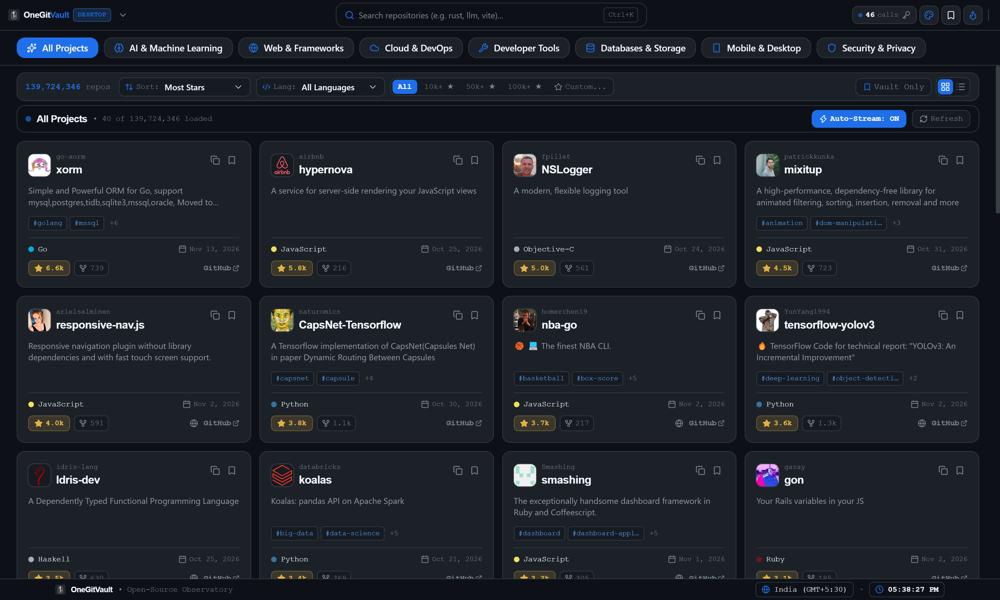
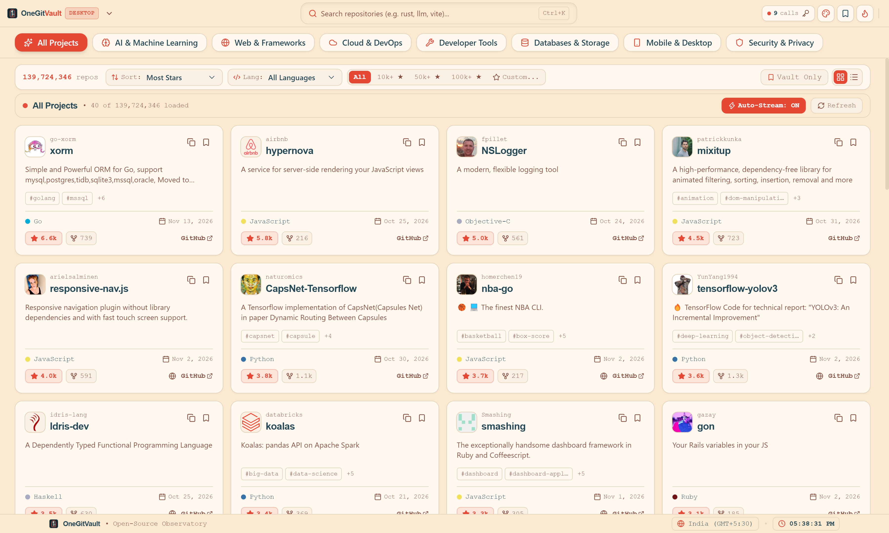
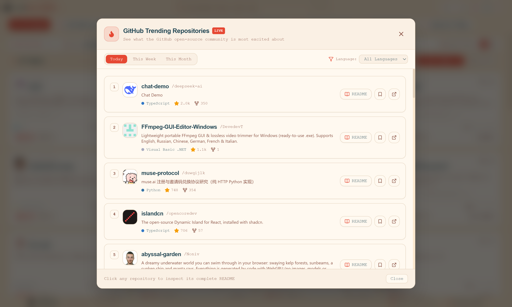
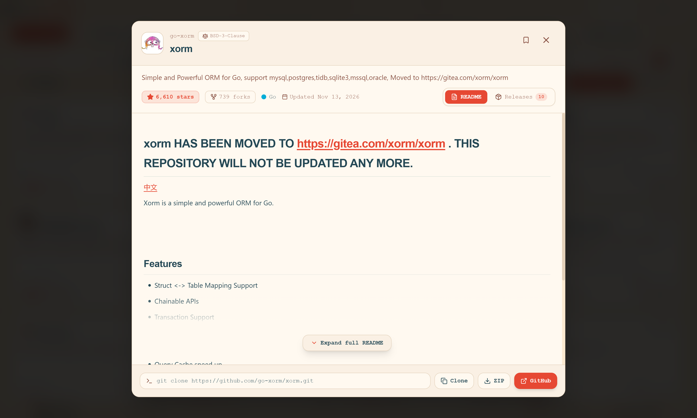
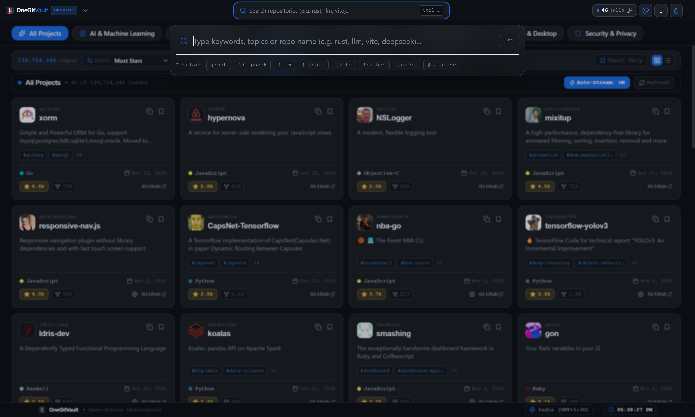
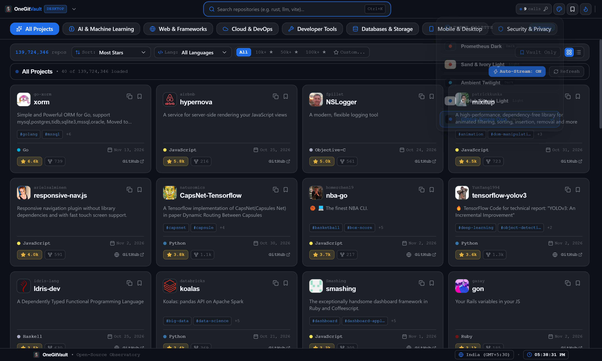
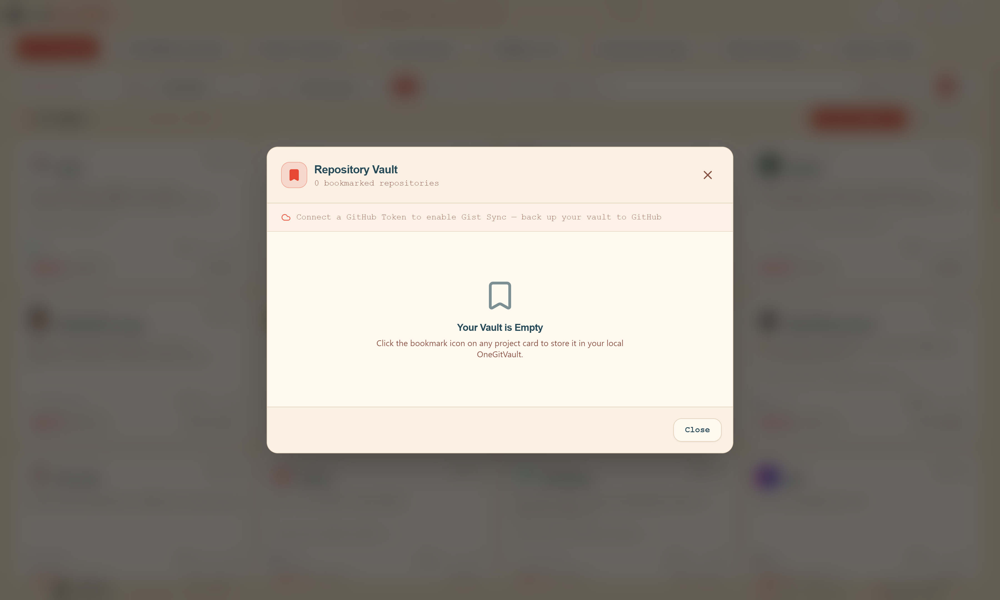
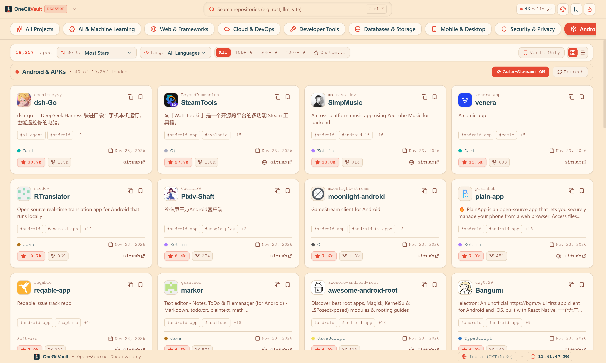
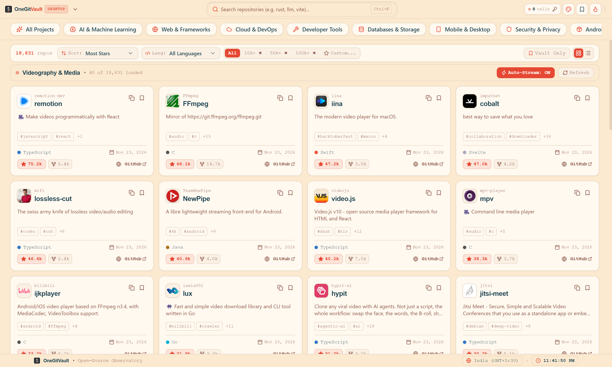
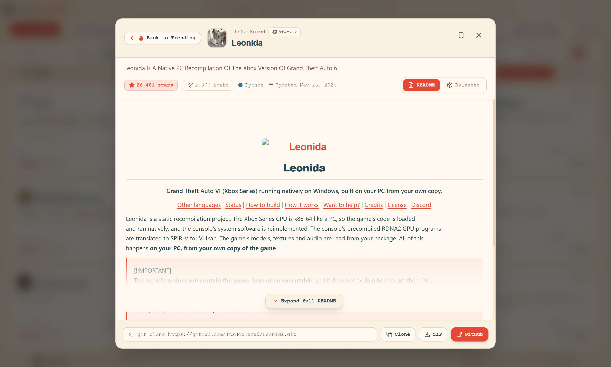

# OneGitVault

<p align="center">
  
</p>

<p align="center">
  <strong>Fast, Standalone Open-Source Repository Observatory & Vault for Windows</strong>
</p>

<p align="center">
  <a href="https://github.com/VKaddala/OneGitVault"></a>
  <a href="https://github.com/VKaddala/OneGitVault/releases"></a>
  <a href="https://react.dev/"></a>
  <a href="https://www.typescriptlang.org/"></a>
  <a href="https://www.electronjs.org/"></a>
  <a href="https://vitejs.dev/"></a>
  <a href="LICENSE"></a>
</p>

---

## 📖 Overview

**OneGitVault** is a standalone native Windows desktop application and modern open-source observatory for discovering, inspecting, bookmarking, and synchronizing high-impact repositories from GitHub.

Built with **React 18**, **TypeScript**, **Tailwind CSS**, and **Electron 33**, OneGitVault eliminates browser clutter by packing real-time repository streaming, a high-density 4-column responsive grid, in-app GitHub trending discovery, instant markdown documentation rendering, release binary downloading, and cross-device cloud synchronization into a distraction-free native desktop environment.

---

## ✨ Complete Feature Tour

### 📐 1. Responsive 4-Column Grid & Compact Cards
- **High-Density Desktop Layout**: Expanded widescreen container (`max-w-[1720px]`) eliminates unused side margins and presents 4 responsive columns (`xl:grid-cols-4 2xl:grid-cols-4`).
- **Feature-Rich Compact Cards**: Streamlined cards preserving 100% of interactive controls:
  - **Instant `git clone` Copy**: Single-click clone URL copy with animated visual checkmark feedback.
  - **One-Click Vault Bookmark**: Bookmark favorite repositories with live counter badge updates.
  - **Interactive Topic Pills**: Direct-filter tags with a single click.
  - **Telemetry & Language Badges**: Official color-coded language dot, license badge (`MIT`, `Apache-2.0`, `GPLv3`), and calendar update timestamps.
  - **Star & Fork Badges**: Real-time metrics formatted compactly (`14.2k`, `1.5M`).

### 🔥 2. In-App GitHub Trending Explorer & Back Navigation
- **Native In-App Modal**: Explore GitHub's trending open-source projects without leaving the desktop app or switching to an external browser tab.
- **Time Ranges**: Toggle instantly between **Daily**, **Weekly**, and **Monthly** trending repositories across the global ecosystem.
- **Deep README Inspection & Seamless Back Navigation**: Click any trending repository to immediately preview its live documentation and release assets. Includes a dedicated **`← 🔥 Back to Trending`** header button (and `Esc` support) that takes you straight back to your exact trending list, preserving your selected time period and language filter without re-fetching lag.

### 🪟 3. Unified Frameless Window Header & Flyout Search
- **Consolidated Window Header**: Combines native window controls (minimize, maximize/restore, close), branding, live API quota badge, trending launcher, vault drawer, and theme selector into a single streamlined top bar.
- **Full-Width Search Flyout**: Press `Ctrl+K` / `Cmd+K` or click the search bar to reveal a responsive search flyout with quick-filter topic tags and instant `Esc` dismissal.
- **Mobile & Narrow-Screen Resilient**: Dynamic flex wrapping prevents horizontal overflow down to 500px window widths.
- **Fixed Theme Palette Trigger**: Permanent palette icon ensures UI consistency across all themes without icon jitter.

### 🎨 4. Modular Plugin-Based Theme Architecture
- **5 Handcrafted Ergonomic Themes**:
  1. **Prometheus Dark**: Deep cinematic petrol teal (`#0c1519` / `#16272f`) with flame vermilion accents (`#e64833`) and biscuit typography.
  2. **Sand & Ivory Light**: Warm biscuit sand canvas (`#FBE9D0`) with crisp ivory containers (`#FFF9F0`) and terracotta highlights.
  3. **Ambient Twilight**: Midnight slate (`#0a0e14` / `#161e2b`) with calming sky-cyan accents (`#38bdf8`) for zero eye strain.
  4. **GitHub Simple Light**: Off-white canvas (`#f6f8fa`) with crisp white elevated cards, dark charcoal typography, and classic GitHub blue highlights (`#0969da`).
  5. **GitHub Simple Dark**: Deep GitHub slate canvas (`#0d1117`) with elevated containers (`#1c2128`), gold star badges (`#e3b341`), and signature blue accents (`#1f6feb`).
- **Elevated Theme Selector**: Floating portal popover with live dual preview swatches, palette descriptions, and active checkmarks.

### 📑 5. README & Release Asset Inspector
- **Markdown Documentation Viewer**: Renders GitHub Flavored Markdown (GFM) with syntax highlighting, tables, callout blocks, and directory trees.
- **DOMPurify Security Sanitization**: Every README is strictly sanitized through DOMPurify to neutralize script injection and malicious payloads in external repositories.
- **Releases Downloader**: Dedicated inspector tab to browse official GitHub release tags, read release notes, and download executable binaries (`.exe`, `.zip`, `.tar.gz`) directly to your machine.
- **Quick Action Footer**: Quick buttons to copy `git clone`, download repository ZIP, open project homepage, or view on GitHub.

### 🔒 6. Vault Bookmarks & GitHub Gist Cloud Sync
- **Local Vault Storage**: Instant bookmarking stored securely via `localStorage`.
- **Cloud Backup & Restore**: Sync your vault across different computers using a private GitHub Gist (`onegitvault-bookmarks.json`).
- **Vault-Only Filter**: Single-click toggle in the toolbar to isolate and browse only your bookmarked repositories.

### 🌐 7. Persistent Location & Live Clock Footer
- **Regional Time & Zone**: Real-time 12-hour ticking digital clock in the persistent bottom footer.
- **Automatic Geo/Country Detection**: Detects and displays the user's country and GMT offset (e.g. `🌐 India (GMT+5:30)`).

### ⭐ 8. Custom Stars Filter Portal
- **Granular Thresholds**: Filter from `All (0+)` stars up to preset tiers (`10k+`, `50k+`, `100k+`) or any custom number (`500`, `2,500`, `25,000+`).
- **Body-Portaled Popover**: Portaled to document root to ensure perfect layering above cards and scroll areas.

### 🗂️ 9. Curated Technology Sectors & Sorting
- **9 Curated Technology Sectors**: Instant filtering across **AI & Machine Learning**, **Web & Frameworks**, **Cloud & DevOps**, **Developer Tools**, **Databases & Storage**, **Mobile & Desktop**, **Security & Privacy**, **Android & APK Releases** (standalone Android applications and direct APK packages), and **Videography & Media** (video editors, ffmpeg tools, encoders, screen recorders, and streaming engines).
- **Multi-Sort Engine**: Sort live by **Most Stars**, **Most Forks**, or **Recently Updated**.
- **Language Filtering**: Live dynamic language filter populated by loaded repository languages.

### ⚡ 10. Rate Limit Quota Manager & Offline Resilience
- **Real-Time Quota Tracking**: Visual meter displaying remaining GitHub API calls (60/hr unauthenticated, 5,000/hr authenticated).
- **Curated Offline Vault**: Zero-downtime offline fallback providing 30+ curated project sets when network connectivity is lost or rate limits are reached.
- **Visual Refresh Feedback**: Animated spinner indicator confirming live network fetch and quota refresh.

### 🔄 11. Automated Background Update Checker
- **GitHub Release Monitoring**: Periodically checks `VKaddala/OneGitVault` releases for new versions.
- **One-Click Upgrades**: Displays release notes, changelogs, and provides direct installer downloads.

---

## 📜 Full Version Release History

### 🚀 v2.0.0
- **Responsive 4-Column Grid**: Expanded container to `max-w-[1720px]` and introduced 4 columns (`xl:grid-cols-4 2xl:grid-cols-4`).
- **In-App GitHub Trending Modal**: Embedded Daily, Weekly, and Monthly trending explorer with direct README inspection.
- **Unified Frameless Header**: Merged native window controls, branding, search flyout, and quota badges into a single slim titlebar.
- **Search Flyout**: Responsive `Ctrl+K` flyout search with quick topic chips and `Esc` dismissal.
- **Custom Star Filter Portal**: Added `All (0+)` stars option and custom star threshold popover portaled to `document.body`.
- **Location & Time Footer**: Replaced old buttons with detected country/timezone and live ticking digital clock.
- **Fixed Theme Icon**: Switched theme button to permanent palette icon to prevent icon clashes.
- **Vertical Scrollbar Refinement**: Positioned scrollbar cleanly below the fixed header sections.

### 🎨 v1.0.4
- **Modular Plugin-Based Theme Engine**: Introduced type-safe `ThemePlugin` contract and central `ThemeRegistry`.
- **5 Ergonomic Themes**: Added Prometheus Dark, Sand Light, Ambient Twilight, GitHub Simple Light, and GitHub Simple Dark.
- **Elevated Theme Selector**: Added dual-swatch preview popover.
- **SOLID Architecture Refactoring**: Extracted `useRepositories`, `useBookmarks`, `rateLimitManager`, and `storageService`.
- **Security Polish**: Integrated DOMPurify markdown sanitization for README rendering.

### 📦 v1.0.3
- **Centered README Modal**: Restyled the repository inspector into a centered modal dialog.
- **Releases Downloader**: Added releases tab to inspect tags, changelogs, and download binary assets directly.
- **Ambient Twilight Theme**: Introduced serene midnight slate and sky-cyan palette.

### ⚡ v1.0.2
- **Prometheus Color Scheme**: Adopted cinematic petrol teal and vermilion flame styling across dark and light modes.
- **Automated Build Versioning**: Added `bump-version.cjs` to manage build numbers.

### 🛠️ v1.0.1
- **Seamless Upgrade Installer**: Inno Setup script updated with auto-uninstall of previous versions to avoid duplicate installations.
- **Startup Speed Improvements**: Optimized Vite bundle compilation and Electron window initialization.

### 🌟 v1.0.0
- **Initial Release**: Standalone native Windows Electron desktop application.
- 7 technology sectors, live search & auto-streaming, local vault with GitHub Gist cloud synchronization, rate limit tracker, offline fallback vault, and Inno Setup installer.

---

## 🏗️ Architecture & Technology Stack

```
OneGitVault/
├── assets/                  # Multi-resolution application icons (.ico, .png)
├── electron/
│   ├── main.cjs             # Electron main process (IPC, window lifecycle, shell integration)
│   └── preload.js           # Secure context-isolated bridge (electronAPI)
├── src/
│   ├── components/          # Modular React components
│   │   ├── TitleBar.tsx     # Frameless window controls, search flyout, header utilities
│   │   ├── CategoryNav.tsx  # Horizontal technology category navigation
│   │   ├── FilterBar.tsx    # Sorting, language filter, stars custom portal, view toggles
│   │   ├── ProjectCard.tsx  # Compact 4-column responsive repository tile
│   │   ├── TrendingModal.tsx# In-app GitHub trending explorer (Daily/Weekly/Monthly)
│   │   ├── RepoDetailPanel.tsx # Centered README & release binary inspector
│   │   ├── BookmarksModal.tsx  # Vault manager with Gist push/pull synchronization
│   │   ├── TokenModal.tsx   # Personal access token management
│   │   └── UpdateModal.tsx  # App release update prompt & changelog viewer
│   ├── hooks/               # Domain hooks (useRepositories, useBookmarks)
│   ├── services/            # Pure services (githubApi, rateLimit, storage, updateService)
│   ├── themes/              # Modular ThemePlugin registry (5 themes)
│   └── types/               # TypeScript domain contracts
├── OneGitVault.iss          # Inno Setup Windows installer compiler script
└── build-installer.bat      # Automated build & packaging script
```

---

## 🚀 Getting Started

### Option 1: Standalone Windows Installer (Recommended)

1. Download **`OneGitVault-Setup-2.0.0.exe`** from [GitHub Releases](https://github.com/VKaddala/OneGitVault/releases).
2. Run the installer. It automatically detects and cleanly upgrades any previous installation without orphan files.
3. Launch **OneGitVault** from your Desktop or Start Menu.

### Option 2: Precompiled Portable Executable

Run the standalone executable directly without installation:
```
release\OneGitVault-win32-x64\OneGitVault.exe
```

### Option 3: Run from Source (Development)

**Prerequisites**: [Node.js](https://nodejs.org/) v18+ and `npm`.

1. **Clone the repository**:
   ```bash
   git clone https://github.com/VKaddala/OneGitVault.git
   cd OneGitVault
   ```

2. **Install dependencies**:
   ```bash
   npm.cmd install
   ```

3. **Start in Desktop Mode (Electron + Vite)**:
   ```bash
   npm.cmd start
   ```

4. **Start in Web Browser Mode**:
   ```bash
   npm.cmd run dev
   ```
   Open `http://localhost:5173` in your browser.

---

## 🔑 GitHub API Token & Gist Sync Setup

OneGitVault functions out-of-the-box with unauthenticated public GitHub API access (60 requests/hour). To unlock **5,000 requests/hour** and **Cross-Device Gist Sync**:

1. Generate a [GitHub Personal Access Token (Classic)](https://github.com/settings/tokens/new?description=OneGitVault&scopes=public_repo,gist) with:
   - `public_repo` (Repository search and inspection)
   - `gist` (Cloud bookmark backup and restore)
2. In OneGitVault, click the **Key / Quota badge** in the header.
3. Paste your token and click **Save Token**.
4. Open the **Vault** drawer to **Push** (backup) or **Pull** (restore) your bookmarks at any time.

> *Note: Tokens are saved strictly in local browser storage (`localStorage`) and communicated directly to official `api.github.com` endpoints.*

---

## ⌨️ Keyboard Shortcuts

| Shortcut | Action |
|---|---|
| `Ctrl + K` / `Cmd + K` | Open / Close Search Flyout |
| `Escape` | Dismiss Open Modals, Popovers, or Search Flyout |
| `Ctrl + R` | Refresh Current Repository Stream |
| `Double Click TitleBar` | Maximize / Restore Window |

---

## 🛠️ Build & Release Commands

| Command | Description |
|---|---|
| `npm.cmd run build` | Compiles TypeScript and builds production web assets via Vite |
| `npm.cmd run desktop` | Starts Vite dev server and launches Electron desktop shell |
| `npm.cmd run package` | Packages standalone Electron binary into `release/OneGitVault-win32-x64/` |
| `node scripts/publish-release.cjs` | Automatically uploads installer binary to GitHub Releases with changelog |

---

## 🖼️ Application Gallery & Interactive Screenshots

### 🌓 1. Dual-Theme Parity (Prometheus Dark & Sand Light)

| Prometheus Dark (4-Column Responsive Grid) | Sand & Ivory Light (4-Column Responsive Grid) |
|:---:|:---:|
|  |  |

---

### 🔥 2. In-App GitHub Trending Explorer & Markdown README Inspector

| In-App GitHub Trending Repositories (Sand Light) | Centered Markdown README Inspector & Actions |
|:---:|:---:|
|  |  |

---

### 🔍 3. Search Flyout, Star Filters & Theme Palette

| Full-Width Search Flyout (`Ctrl+K`) | Custom Min-Stars Popover (`0+` to Custom) |
|:---:|:---:|
|  |  |

| Floating Theme Palette Selector | Vault Bookmarks & Cloud Gist Sync |
|:---:|:---:|
|  |  |

---

### 📱 4. Android Releases, Videography Tools & Back Navigation

| Android & APK Releases Sector | Videography & Media Tools Sector |
|:---:|:---:|
|  |  |

| Seamless Back to Trending Navigation |
|:---:|
|  |

---

## 📜 License

Distributed under the **GPL-3.0 license**. Designed and developed by [VKaddala](https://github.com/VKaddala).
